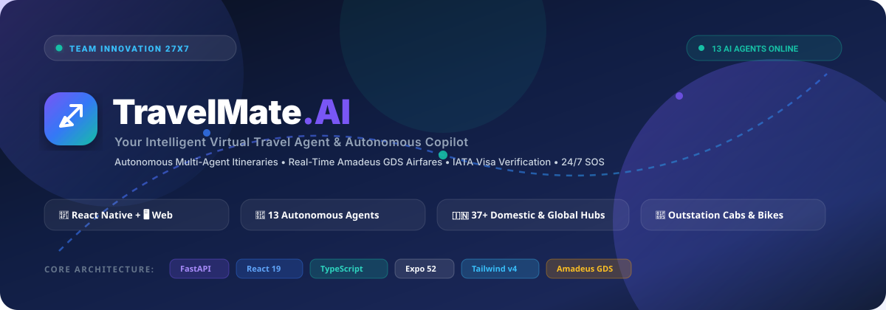
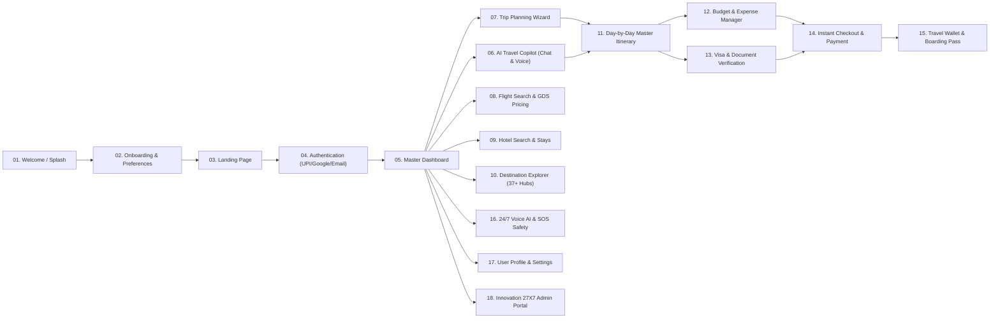
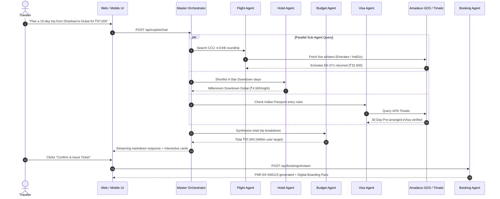
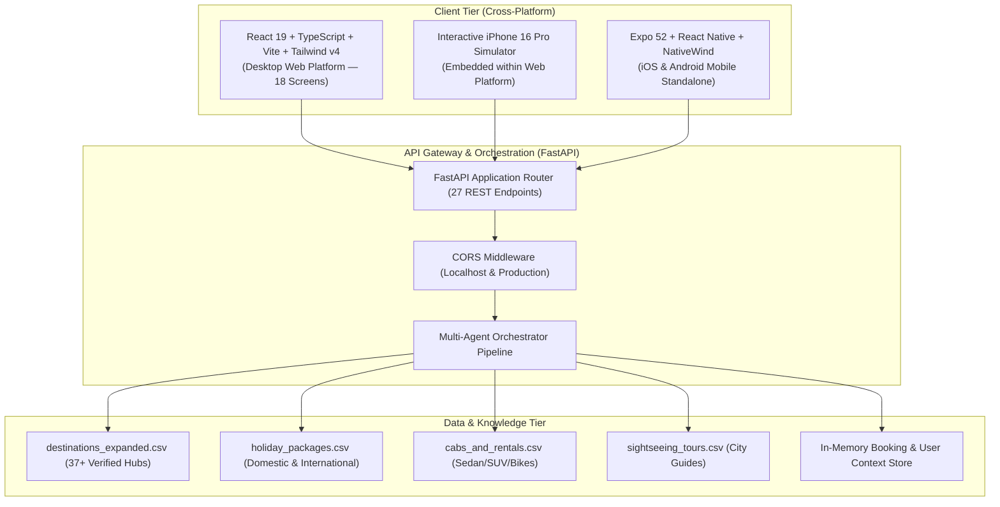

<div align="center">



# TravelMate AI – Intelligent Virtual Travel Agent & Copilot
### **Team Innovation 27X7 — AI Agents & Intelligent Systems**

[](https://fastapi.tiangolo.com)
[](https://react.dev)
[](https://www.typescriptlang.org)
[](https://expo.dev)
[](https://tailwindcss.com)
[](https://python.org)

**"Your world. Your journey. Your AI copilot."**

[Live Web Demo](http://localhost:3000) • [API Documentation](http://localhost:8000/docs) • [Mobile App Codebase](./mobile) • [Architecture Diagrams](#-system-architecture--diagrams)

---

</div>

## 📌 Executive Summary

**TravelMate AI** is an enterprise-grade autonomous travel platform developed by **Team Innovation 27X7**. It bridges the gap between fragmented travel portals by deploying a coordinated swarm of **13 autonomous AI agents** capable of orchestrating personalized itineraries, querying real-time airfares, shortlisting hotels, calculating dynamic multi-currency budgets, validating IATA visa regulations, and arranging local mobility (outstation cabs, self-drive cars, and bike rentals).

The platform provides a dual experience:
1. **Full-Spectrum Desktop Web Workspace**: Featuring 18 specialized operational screens, interactive map view, dynamic day-by-day scheduler, visa document vault, and admin operations dashboard.
2. **Native Mobile App & Interactive iPhone Simulator**: Built using React Native & Expo Router with bottom tab navigation, gesture cards, audio wave voice assistance, and 1-tap checkout.

---

## 🏗️ System Architecture & Diagrams

### Diagram 1: Autonomous 13-Agent Swarm Architecture
The core intelligence runs on a hierarchical multi-agent framework where the **Master Orchestrator** decomposes natural language user prompts and delegates tasks in parallel to specialized sub-agents.

```mermaid
graph TD
    User["👤 User (Natural Language / Voice / Touch)"] --> Orchestrator["🧠 Master Orchestrator Agent"]
    
    subgraph AI_Agent_Swarm ["Team Innovation 27X7 — Autonomous Agent Swarm"]
        Orchestrator --> Planner["🗺️ Travel Planner Agent"]
        Orchestrator --> Flight["✈️ Flight Strategist Agent"]
        Orchestrator --> Hotel["🏨 Hotel Booking Agent"]
        Orchestrator --> Dest["🧭 Destination Agent"]
        Orchestrator --> Budget["💰 Budget & Expense Agent"]
        Orchestrator --> Visa["🛂 Visa & Document Agent"]
        Orchestrator --> Transport["🚕 Mobility & Cab Agent"]
        Orchestrator --> Voice["🎙️ Multilingual Voice Agent"]
        Orchestrator --> Safety["🛡️ 24/7 Emergency SOS Agent"]
        Orchestrator --> Pack["🎒 Holiday Package Agent"]
        Orchestrator --> Recom["⭐ Smart Recommendation Agent"]
        Orchestrator --> Weather["🌤️ Weather & Seasonality Agent"]
        Orchestrator --> BookMaster["🎟️ Booking Fulfillment Agent"]
    end

    subgraph Data_Integrations ["External Integrations & Real-Time Engines"]
        Flight --> Amadeus["Amadeus GDS / Skyscanner API"]
        Visa --> Timatic["IATA Timatic Visa Engine"]
        Dest --> GeoData["37+ Verified Indian & Global Database"]
        Transport --> FleetDB["Local Outstation & Rental Fleet"]
        Budget --> FX["Open Exchange Rates Multi-Currency"]
    end

    Planner --> ItineraryOutput["Structured 10-Day Day-by-Day Master Plan"]
    BookMaster --> ConfirmedVoucher["PNR Ticket, Digital Boarding Pass & QR Voucher"]
```



---

### Diagram 2: Complete User Journey & Screen State Flow
Users transition seamlessly through the 18 interconnected web and mobile states.



---

### Diagram 3: Autonomous Booking & Consensus Sequence
How sub-agents execute parallel requests, build consensus, and lock pricing for checkout.



---

### Diagram 4: Hybrid Tech Stack & Deployment Topology



---

## 📱 Mobile App UI & Animation Design

Designed strictly according to the **Team Innovation 27X7 Design System**:

| Element | Specification |
|:---|:---|
| **Primary Color** | Deep Navy `#101B35` |
| **Accent Color** | Electric Blue `#3478F6` |
| **Secondary Color** | Travel Teal `#19B9A5` |
| **AI Purple** | `#7956F5` |
| **Background** | Clean Cloud White `#F5F7FB` |
| **Cards** | Pure White `#FFFFFF`, `rounded-[20px]`, soft elevation shadow |
| **Buttons** | `rounded-[14px]`, gradient fill |
| **Navigation** | Bottom Tab Bar (`Home`, `Explore`, `Copilot`, `Packages`, `My Trips`) |
| **Animations** | Button press scale `0.97` (120ms), card entrance `translateY` (350ms), bottom nav icon scale `1.15` (180ms), favourite heart pop `300ms`, booking success checkmark. |

### Mobile Screens Implemented:
1. **Welcome / Splash Screen**: Animated logo, globe rotation, and airplane flight path.
2. **Home Dashboard**: Greeting `"Hi, Ranjeet! 👋"`, Dhanbad location pill, search bar, AI Copilot hero card, 6 quick service buttons, curated packages carousel, and top destination list.
3. **Explore Destinations**: Instant toggle between `All`, `Near Me (Jharkhand/Bihar/WB)`, `🇮🇳 India Domestic`, and `🌍 World International`.
4. **AI Travel Copilot**: Multilingual chat (English & हिन्दी), voice recording waveform, real-time typing animation, and 1-tap booking cards.
5. **Holiday Packages & Mobility**: Curated tour packages, outstation cabs (AC Dzire Sedan & Ertiga SUV), self-drive cars, and bike rentals (Royal Enfield Himalayan, Activa 6G).
6. **Instant Booking & UPI Checkout**: Traveler details, coupon code (`INNOVATION27X7` for ₹1,500 OFF), instant UPI selection, and booking voucher.
7. **My Trips & Boarding Pass**: Active Dubai countdown, expense tracking, and scannable digital boarding pass QR modal.
8. **Profile & Travel Wallet**: TravelMate Coins balance (₹4,500 available), passport locker, and 24/7 SOS helpline.

---

## 🖥️ Complete 18 Web Application Screens

| # | Screen Name | Key Capabilities |
|:---:|:---|:---|
| **01** | **Splash / Welcome** | Immersive 3D flight path, brand identity, globe rotation animation. |
| **02** | **Onboarding & Preferences** | Currency (`INR`, `USD`, `EUR`, `AED`), travel pace, dietary & cabin preferences. |
| **03** | **Landing Page** | Value proposition, interactive hero search, featured destinations, live agent counter. |
| **04** | **Login & Registration** | One-tap demo login (Ranjeet Kumar), Google & GitHub OAuth, UPI quick-link. |
| **05** | **User Dashboard** | Upcoming Dubai countdown, saved flights/hotels, quick actions, recommended hubs. |
| **06** | **AI Travel Copilot** | 13-agent swarm monitor, speech-to-text voice input, text-to-speech voice output. |
| **07** | **Trip Planning Wizard** | Multi-step trip generator (destination, dates, travelers, budget tier). |
| **08** | **Flight Search & Booking** | Amadeus GDS price comparator, layover filters, seat map preview. |
| **09** | **Hotel Search & Booking** | Star rating, amenities (pool, gym, Burj Khalifa view), refundable rates. |
| **10** | **Destination Explorer** | 37+ Indian local & international hubs, distance from Dhanbad, daily budget filter. |
| **11** | **Itinerary Management** | 10-day master schedule, hourly timeline, map coordinates, custom notes. |
| **12** | **Budget & Expenses** | Category allocation pie chart, daily spend tracker, multi-currency conversion. |
| **13** | **Visa & Documents** | IATA Timatic rules, passport validity checker, required checklist, eVisa status. |
| **14** | **Payment & Checkout** | UPI QR payment, credit card tokenization, coupon codes, invoice generation. |
| **15** | **My Trips & Travel Wallet** | E-tickets, boarding passes with QR codes, PNR status, TravelMate Coins. |
| **16** | **Voice Assistant & SOS** | Voice AI assistant, embassy contacts, hospital helpline, emergency GPS broadcast. |
| **17** | **Profile & Settings** | Personal info, passport locker, currency preferences, dark/light theme toggle. |
| **18** | **Admin Dashboard** | Swarm health telemetry, system latency monitor, booking logs, GDS API metrics. |

---

## 🔌 API Reference (FastAPI Backend)

| Method | Endpoint | Description |
|:---|:---|:---|
| `GET` | `/api/health` | Backend and agent swarm health check |
| `GET` | `/api/agents` | Status of all 13 autonomous AI agents |
| `POST` | `/api/copilot/chat` | Main conversational Copilot endpoint |
| `GET` | `/api/destinations` | Dynamic catalog of 37+ verified destinations |
| `POST` | `/api/destinations/search` | Search destinations by query, region, budget |
| `GET` | `/api/destinations/{id}` | Detailed destination guide & seasonality |
| `GET` | `/api/packages` | Curated domestic & international holiday packages |
| `POST` | `/api/packages/search` | Filter packages by category and budget |
| `POST` | `/api/packages/{id}/book` | Instant package reservation |
| `GET` | `/api/cabs` | Available outstation & city cabs |
| `POST` | `/api/cabs/search` | Route pricing (e.g. Dhanbad ➔ Ranchi) |
| `POST` | `/api/cabs/book` | Outstation cab reservation |
| `GET` | `/api/rentals/cars` | Self-drive car rental fleet |
| `GET` | `/api/rentals/bikes` | Bike rental fleet (Goa, Manali, Ladakh) |
| `GET` | `/api/sightseeing` | City sightseeing tours and passes |
| `GET` | `/api/itinerary/active` | Current 10-day active trip itinerary |
| `POST` | `/api/flights/search` | Query flight options with GDS pricing |
| `POST` | `/api/hotels/search` | Query hotels with amenities & reviews |
| `POST` | `/api/visa/check` | IATA Timatic passport & entry verification |
| `POST` | `/api/budget/calculate` | Dynamic multi-currency expense model |
| `POST` | `/api/bookings/instant` | Issue booking voucher and PNR |

---

## 🚀 Quickstart Guide

### Prerequisites
- **Node.js** v18+ & **npm**
- **Python** 3.10+
- **Git**

### 1. Clone & Setup
```bash
git clone https://github.com/Ranjeet7680/Travel-Mate-AI.git
cd Travel-Mate-AI
```

### 2. Run Desktop Web Platform
```bash
cd frontend
npm install
npm run dev
```
Open [http://localhost:3000](http://localhost:3000) in your browser.

### 3. Run FastAPI Backend
```bash
cd backend
python -m venv venv
# Windows:
.\venv\Scripts\activate
# macOS/Linux:
source venv/bin/activate

pip install -r requirements.txt
python main.py
```
Open [http://localhost:8000/docs](http://localhost:8000/docs) for the interactive Swagger UI.

### 4. Run Mobile App (Expo)
```bash
cd mobile
npm install
npm run start
```
- Press `i` to launch in the iOS Simulator.
- Press `a` to launch in the Android Emulator.
- Scan the QR code using the **Expo Go** app on your physical mobile device.

---

## 👥 Team Innovation 27X7

- **Project Lead**: Ranjeet Kumar
- **AI Agent Framework**: Hierarchical Multi-Agent Consensus Architecture
- **Domain**: Virtual Travel Agent Copilot & Mobility Booking Systems
- **Organization**: Team Innovation 27X7

---

<div align="center">
  <sub>Built with ❤️ by Team Innovation 27X7. © 2026 TravelMate AI. All rights reserved.</sub>
</div>
